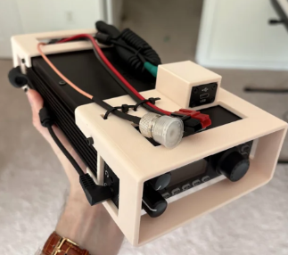
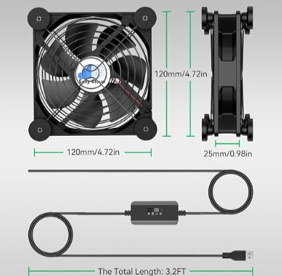

# G90-Case
A 3d print design project for the Xeigu G90

## Inspiration

I think this case does a great job showing front-back case construction. I'd like to do something similar, and add 
- bridge the distance betwen the front and the back
- add a capability to add a fan
- add a raspberry-pi holder capability 
- more wire-management routing
- feet for standalone use

## Cooling Fan
[This](https://www.amazon.com/Easy-Cloud-Controller-Greenhouse-PlayStation/dp/B0DHXBC7GJ/ref=sr_1_7_sspa?crid=3ABTTCJCPJ3ZO&dib=eyJ2IjoiMSJ9.cCiHXEdOPTqS9H8UhnXiVqSJ_bhszCxPH9NR0RQxKI9HExkQQd1mwVOGJol6xKGTvsozEgw7kWFd4ga9ptBkga0WQydyCe7XhDWcj0rdYZ67RJ5DrhjCmR7LEGQp-VTgpDGV7FlgM2jHLUj_ft3fJTut43N82pVd7EYbkeUSarHqTHU9jclsGBsSIxgtQzAsl18XMQqObRFSUm7SuKcxj_LDpUM8z-8NDqn3qXMiAVo.5Wt0USFEqLHXRdAS7XFwJF3sgfXx15PVmwSsqxY93AM&dib_tag=se&keywords=computer+fan&qid=1792519172&sprefix=computer+f%2Caps%2C255&sr=8-7-spons&sp_csd=d2lkZ2V0TmFtZT1zcF9tdGY&psc=1) seems like an easy enough option to use. 

